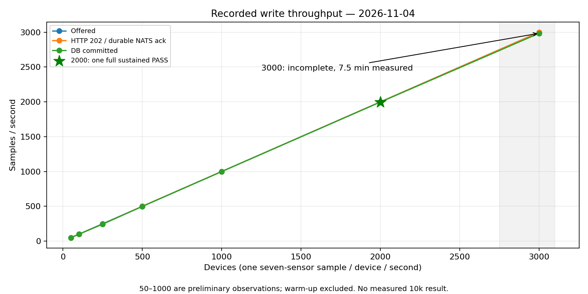
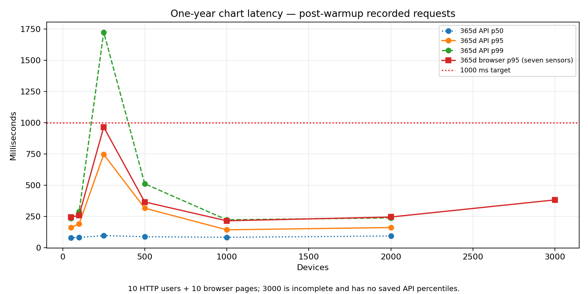
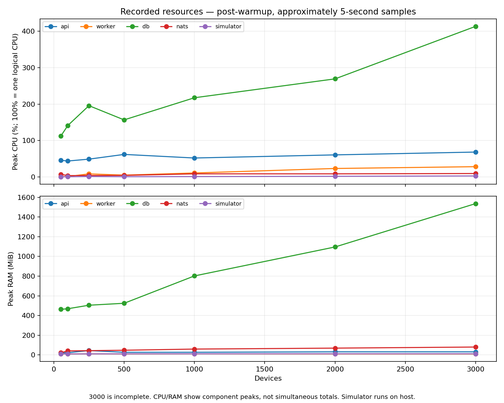

# Load-test execution report — 2026-11-04

Testing stopped at the user’s request. No new load tests were run to produce this analysis; the queued 10,000-device stress phase was cancelled. Test containers are stopped and volumes preserved.

The highest fully instrumented single sustained PASS is 2,000 devices: 905.63 measured seconds, 2,000.03 accepted samples/s, 1,997.30 committed samples/s, annual API p95 160.69 ms, browser p95 245 ms, visibility-lag p95 conservatively bounded above by 8.56 seconds, and zero errors. All 2,060,000 accepted samples were stored.

The 3,000-device interval is incomplete: 450.24 measured seconds, 2,999.92 accepted/s, 2,984.93 committed/s, browser p95 382 ms. API percentiles were not persisted on interruption. It is INCONCLUSIVE, not a measured capacity failure.

Maximum sustainable capacity is not established: boundary repeats and soak were not completed. No definitive first failing component at 10k was measured. Database resource growth makes the worker/database write path a candidate. Separately, the code’s 2 GiB NATS LimitsPolicy retains acknowledged messages; using the observed approximately 174.9 bytes/sample gives an estimated 20.5-minute fill time at 10k samples/s from an empty stream. This is an extrapolation, not a 10k measurement.

[Full Persian report, hardware, methodology, limitations, recommendations and evidence](load-test-report-fa-2026-11-04.md).

