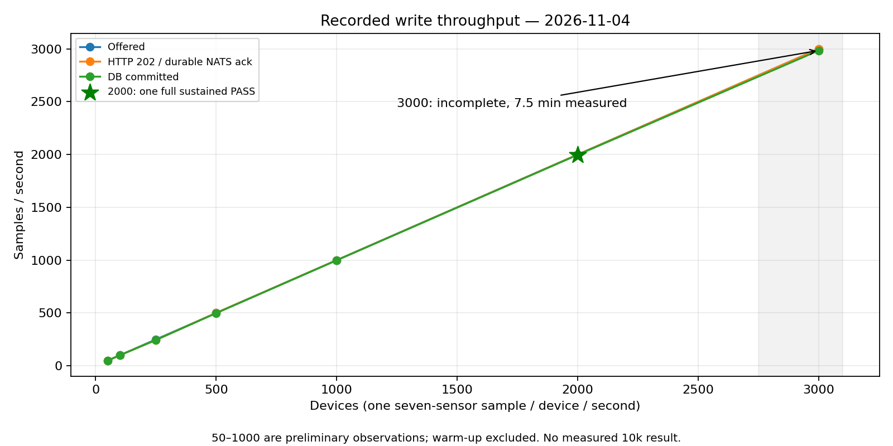
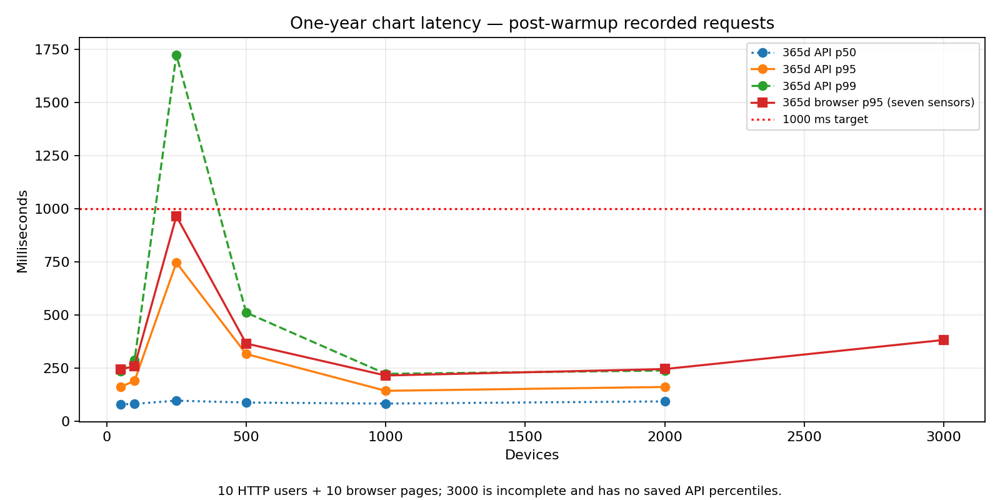
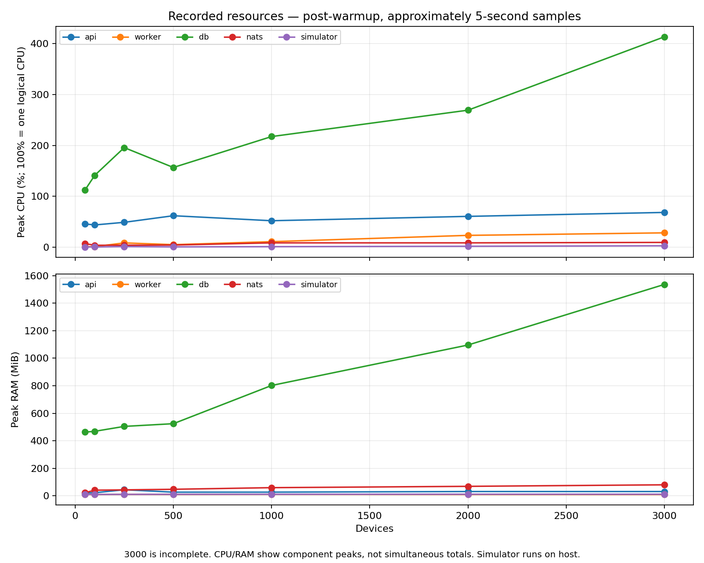

# گزارش تست بار — ۴ نوامبر ۲۰۲۶

این گزارش فقط بر نتایج ثبت‌شده تکیه دارد. با درخواست کاربر، اجرای جاری متوقف و مرحلهٔ ۱۰ هزار دستگاه لغو شد؛ برای تهیهٔ این گزارش تست بار جدیدی اجرا نشد.

## نتیجهٔ ظرفیت

بالاترین مرحلهٔ قبول‌شده **۲٬۰۰۰ دستگاه** است: پس از ۱۲۰ ثانیه گرم‌شدن، ۹۰۵٫۶۳ ثانیه اندازه‌گیری انجام شد. این یک مرحلهٔ پایدار موفق است؛ بیشینهٔ واقعی سخت‌افزار اثبات نشده، زیرا آزمون مرزی تکرارشده و soak تکمیل نشده‌اند. مرحلهٔ ۳٬۰۰۰ دستگاه هنگام توقف کاربر فقط ۴۵۰٫۲۴ ثانیه دادهٔ پس از گرم‌شدن داشت؛ بنابراین نه قبولی پایدار و نه شکست ظرفیت محسوب می‌شود.

## سخت‌افزار و محیط

| مورد | مشخصات ثبت‌شده |
|---|---|
| CPU | Intel Core i7-1165G7 @ 2.80 GHz؛ ۴ هسته و ۸ پردازندهٔ منطقی |
| RAM | حدود ۱۵٫۴ GiB |
| دیسک میزبان | Samsung MZVLQ256HAJD-00000، NVMe SSD با ظرفیت ۲۳۸٫۵ GiB |
| فضای آزاد ابتدای اجرا | حدود ۲۰ GiB |
| سیستم‌عامل | Ubuntu 22.04.5 LTS؛ Linux 6.8.0-138-generic |
| Docker / Compose | 29.1.3 / 2.40.3 |
| دیتابیس | TimescaleDB 2.17.2 / PostgreSQL 16.6 |
| صف | تصویر nats:2.10-alpine |
| محدودیت کانتینرها | بدون سهمیهٔ اختصاصی CPU/RAM؛ منابع میزبان مشترک |
| کد | commit 6e2f613 همراه تغییرات ابزار اندازه‌گیری؛ شناسهٔ دقیق تصاویر در inventory موجود است |

شبیه‌ساز، مرورگرها و سرویس‌ها روی یک میزبان بودند. استقرار قبلی و بارهای دیگر میزبان فعال ماندند؛ بنابراین نتیجه به همین محیط مربوط است. استقرارهای آزمایش حجم‌های جداگانه داشتند. کانتینرهای آزمایش متوقف شده‌اند و حجم‌ها حذف نشده‌اند. تطابق سورس تصاویر ازپیش‌ساختهٔ API/Worker با commit به‌صورت مستقل اثبات نشده؛ شناسهٔ تصاویر ثبت شده است.

## روش و معیارها

هر دستگاه یک نمونه در ثانیه با هفت سنسور تولید می‌کرد؛ اندازهٔ batch حداکثر ۴۰۰ بود. ۱۰ کاربر HTTP درخواست‌های ۱ ساعت، ۷ روز و ۳۶۵ روز را اجرا می‌کردند؛ ۱۰ صفحهٔ مرورگر نیز نمودار سالانه با هفت سنسور را رسم می‌کردند. هر کاربر پس از پایان درخواست یک ثانیه صبر می‌کرد. p95 مرورگر شامل درخواست تا پس از رسم و دو animation frame است.

تاریخچه شامل ۸٬۷۶۱ نمونهٔ واقعاً ذخیره‌شده با فاصلهٔ یک ساعت، برای یک دستگاه و پوشش دقیق ۳۶۵ روز است؛ سال کامل با نرخ ۱ Hz تولید نشده است. این تراکم پایین بر نمایندگی سناریوی داده اثر دارد؛ ردیف‌های rollup ساعتی واقعاً وجود دارند.

معیارهای اصلی: حداقل ۹۹٪ بار پیشنهادی در DB، عدم رشد پایدار صف با اجازهٔ نوسان دو پیام، خطای غیرقابل‌بازیابی صفر، p95 نمودار کمتر از ۱۰۰۰ ms، و کران بالای p95 تأخیر مشاهده کمتر از ۱۰ ثانیه. پروب تأخیر دستگاه آخر هر tick را هر پنج ثانیه از chart API می‌خواند؛ مقدار آن یک کران بالای محافظه‌کارانه است. داده‌های گرم‌شدن از صدک‌ها حذف شده‌اند.

## اندازه‌گیری‌ها

| دستگاه | زمان اندازه‌گیری s | پذیرفته‌شده/s | ثبت‌شده در DB/s | API سالانه p95 ms | مرورگر p95 ms | وضعیت |
|---:|---:|---:|---:|---:|---:|---|
| 50 | 175.56 | 50.13 | 49.84 | 161.4 | 242.5 | مقدماتی / ناکافی برای ظرفیت نهایی |
| 100 | 175.15 | 99.91 | 99.91 | 189.1 | 258.9 | مقدماتی / ناکافی برای ظرفیت نهایی |
| 250 | 177.80 | 244.66 | 244.66 | 746.2 | 964.8 | عدم تحقق نرخ در اجرای کوتاه |
| 500 | 175.40 | 501.72 | 498.87 | 315.8 | 365.3 | مقدماتی / ناکافی برای ظرفیت نهایی |
| 1000 | 895.57 | 1000.48 | 999.36 | 142.6 | 214.7 | مقدماتی / ناکافی برای ظرفیت نهایی |
| 2000 | 905.63 | 2000.03 | 1997.30 | 160.7 | 245.0 | قبولی یک مرحلهٔ پایدار |
| 3000 | 450.24 | 2999.92 | 2984.93 | — | 382.0 | مقدماتی / ناکافی برای ظرفیت نهایی |

نوسان اجرای ۲۵۰ دستگاه در مراحل ۵۰۰، ۱٬۰۰۰ و ۲٬۰۰۰ تکرار نشد؛ بنابراین آن را مرز ظرفیت نمی‌دانیم. API صدک‌های ۳٬۰۰۰ دستگاه هنگام توقف ذخیره نشد؛ خط تیره به معنی دادهٔ ناموجود است. اندازه‌گیری اولیهٔ ۱٬۰۰۰ دستگاه ۸۹۵٫۵۷ ثانیه بود و شروط کامل ابزار جدید را نداشت. یک اجرای قبلی ۲٬۰۰۰ دستگاه هنگام تعویض ابزار نیز ناقص ماند و از جدول و گراف‌ها کنار گذاشته شده است.

در مرحلهٔ قبول‌شدهٔ ۲٬۰۰۰ دستگاه، هر ۲٬۰۶۰٬۰۰۰ نمونهٔ پذیرفته‌شده پس از تخلیهٔ صف در دیتابیس وجود داشت؛ پوشش هر ۲٬۰۰۰ دستگاه تأیید شد. خطای انتشار، HTTP و مرورگر صفر بود. شیب صف حدود ‎−۰٫۰۰۱۰۱ پیام/s و کران بالای p95 تأخیر مشاهده ۸٫۵۶ ثانیه بود.

## گراف‌های الزامی

فقط دادهٔ اندازه‌گیری‌شده رسم شده است؛ هیچ نقطهٔ تخمینی برای ۱۰ هزار دستگاه وجود ندارد. وضعیت ناقص ۳٬۰۰۰ دستگاه روی گراف‌ها مشخص شده است.

در گراف منابع، CPU برابر ۱۰۰٪ یعنی یک پردازندهٔ منطقی؛ قله‌های اجزا الزاماً هم‌زمان نیستند. RAM شامل اثر داده و cache انباشته‌شده است و نباید مستقیماً به حافظهٔ لازم برای هر دستگاه تعمیم داده شود.

## گلوگاه کجاست؟

**نقطهٔ اشباع قطعی مشاهده نشده است.** در ۳٬۰۰۰ دستگاه، backlog شروع اجرا طی گرم‌شدن تخلیه شد. پس از گرم‌شدن، نرخ DB حدود ۹۹٫۵٪ بار پیشنهادی و p95 مرورگر ۳۸۲ ms بود؛ اجرای ناقص اجازهٔ نتیجه‌گیری نهایی نمی‌دهد.

دیتابیس مهم‌ترین نامزد محدودیت است: قلهٔ CPU آن از ۲۶۹٪ در ۲٬۰۰۰ دستگاه به ۴۱۴٪ در ۳٬۰۰۰ رسید، در حالی که قلهٔ Worker حدود ۲۳٪ و ۲۸٪، و شبیه‌ساز حدود ۱٫۸٪ و ۲٫۷٪ بود. RAM دیتابیس تقریباً از ۱٬۰۹۶ به ۱٬۵۳۶ MiB رسید. متوسط CPU کل میزبان در این دو مرحله ۴۷٫۶٪ و ۵۸٫۸٪ بود؛ این شواهد غالب‌بودن هزینهٔ دیتابیس را نشان می‌دهد، نه اشباع اثبات‌شدهٔ کل سخت‌افزار.

در کد، هر batch علاوه بر درج raw و به‌روزرسانی دو rollup در یک تراکنش، برای هر دستگاه یک دستور جداگانهٔ درج/بررسی catalog می‌فرستد؛ Worker پیام‌ها را ترتیبی پردازش می‌کند. این مسیر می‌تواند با افزایش بار به محدودیت round-trip، CPU یا I/O برسد؛ تفکیک قطعی علت نیازمند profiling است و در نتایج فعلی انجام نشده است.

## اگر بار به ۱۰٬۰۰۰ دستگاه برسد

آزمون ۱۰٬۰۰۰ دستگاه اجرا نشد؛ بنابراین تعیین قطعی اولین جزء شکست‌خورده ممکن نیست. پیش‌بینی محتمل، عقب‌افتادن مسیر Worker → TimescaleDB از نرخ ورودی و سپس رشد Pending و تأخیر مشاهده است. داده‌های فعلی نشان نمی‌دهند که شبیه‌ساز از نظر CPU اشباع شده باشد، اما انتشار ترتیبی آن نیز می‌تواند در بار بالاتر بار واقعی را کمتر از بار پیشنهادی کند.

یک محدودیت مستقل در صف وجود دارد: طبق تنظیمات کد، JetStream از LimitsPolicy با سقف ۲ GiB، نگهداری ۴۸ ساعت و DiscardNew استفاده می‌کند. در اجرای واقعی، حجم پیام‌های ACK‌شده هم در storage باقی می‌ماند. از دادهٔ ۲٬۰۰۰ دستگاه حدود ۱۷۴٫۹ بایت به‌ازای هر نمونه به دست می‌آید؛ اگر همین نسبت در ۱۰٬۰۰۰ نمونه/s برقرار بماند، سقف ۲ GiB از صف خالی حدود **۲۰٫۵ دقیقه** بعد پر می‌شود. این محاسبهٔ برآوردی است، نه شکست مشاهده‌شده در ۱۰ هزار دستگاه. در آن حالت انتشار جدید رد می‌شود، حتی اگر backlog مصرف‌کننده کم باشد.

تغییرات پیشنهادی به ترتیب بررسی:

1. درج گروهی catalog دستگاه‌ها به‌جای حلقهٔ INSERT جداگانه، سپس اندازه‌گیری هزینهٔ تراکنش، WAL، indexها و دو rollup. درج raw در کد فعلی از قبل batch است.
2. بررسی افزایش کنترل‌شدهٔ Workerها پس از سنجش contention روی rollup، حفظ idempotency و صحت تراکنش‌ها. اثر بهبود بدون آزمون مقایسه‌ای ادعا نمی‌شود.
3. اصلاح سیاست نگهداری NATS متناسب با نیاز replay؛ اگر صف فقط یک گروه مصرف‌کننده دارد، حذف پیام پس از ACK یا WorkQueuePolicy بررسی شود. صرفاً افزایش سقف حجم، مشکل تجمع پیام را عقب می‌اندازد.
4. برای نتیجه‌گیری دربارهٔ ظرفیت خالص سرور، بار مرورگر/ژنراتور از میزبان سرویس‌ها جدا شود.

## شواهد

- [دادهٔ تجمیع‌شده برای ساخت گراف‌ها](load-test-report-assets/recorded-results.json)
- [نتیجهٔ کامل مرحلهٔ ۲٬۰۰۰ دستگاه](../loadtest/results/completion-20261104/capacity/00-2000/summary.json)
- [CSV مرحلهٔ ۲٬۰۰۰ دستگاه](../loadtest/results/completion-20261104/capacity/00-2000/samples.csv)
- [CSV ناقص مرحلهٔ ۳٬۰۰۰ دستگاه](../loadtest/results/completion-20261104/capacity/01-3000/samples.csv)
- [مشخصات میزبان و شناسهٔ تصاویر](../loadtest/results/completion-20261104/capacity/before/)

تست‌های Go و smoke پیش از توقف موفق بودند. آزمون مرزی تکرارشده، soak و سناریوی ۱۰ هزار دستگاه تکمیل نشده‌اند؛ ادعای «بیشینهٔ قطعی ۲٬۰۰۰ دستگاه» یا «شکست اندازه‌گیری‌شده در ۱۰ هزار دستگاه» پشتیبانی ندارد.
